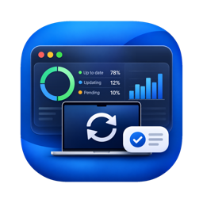

  

# Software Update Dashboard

*Which devices are on the update their Blueprint asks for, and why the others aren’t yet.*

A read-only Mac app that shows, for the devices a Blueprint is scoped to, whether they are on the OS version its software update asks for, and if not, why not.

## Features

- **Tracked Blueprints:** a Blueprint with a software update; its devices are those of the groups it’s scoped to, iPads, iPhones and Macs together, each counted once. Scope changes show in the history. Compare with any group to see which of its devices the Blueprint doesn’t reach.
- **A target per device:** a specific version, the newest release, or the newest minor release of the device’s own major, from Apple’s release data. A release is the target from the day Apple posts it publicly; the Blueprint’s delay only sets the deadline, in the device’s local time. A table per platform and major release on the dashboard. An “Update started” date can be set by hand.
- **Nine categories with a diagnosis** for every device: on target, in progress, other update, failed, not started, no activity, offline, no report, and hardware that can’t run the target. The diagnosis says in plain language what stands in the way, such as a passcode, a download problem or a deadline still to come. A device whose target can’t be determined (for example a beta of a newer major) is shown as “Target unknown” with the reason, and isn’t counted.
- **Blueprint health:** each of the Blueprint’s software update declarations by name, one row per version range, with how many devices report it applied, pending, awaiting sync, failed or invalid, and the most common reason. The device list says when a device is on a version the Blueprint’s update doesn’t cover yet, or hasn’t fetched Jamf’s current declarations.
- **Readiness:** how many devices can’t get an enforced update as they are: iPhones and iPads enrolled with User Enrollment, Macs that aren’t supervised, devices without declarative device management, and devices that never reported. Each number opens those devices in the list.
- **Earlier steps:** when Apple posts a newer version during an update, a device still installing the version the Blueprint asked for before is measured against the newer one and its deadline, with the earlier version shown as the step it installs first.
- **Inspect:** the likely cause for a device, from its inventory, status report and declaration reports, with the Blueprint’s declarations for the device’s own platform. Where the cause is a known problem, Inspect links to it in Help.
- **Help** (Help › Software Update Dashboard Help, ⌘?): how each category is decided, where targets and deadlines come from, what Readiness counts and what Inspect does, and Known Problems, each with a link to Apple’s own page about it.
- **Find a Device** (⇧⌘F): a device by serial number or name in every tracked Blueprint, opened in its Blueprint’s device list.
- **Open in Jamf Pro:** a device (from its detail, the device list or Device › Open in Jamf Pro, ⌥⌘O) or the Blueprint, in your browser, read-only. It uses the Jamf Pro web address you add to the connection in Settings › Connections.
- **Device details:** Rapid Security Response, beta program, why the pending update started, failures, FileVault and battery health; all of a device’s status items on request, with a filter and Copy (not saved).
- **History** of every refresh, per tracked Blueprint.
- **Unsupported hardware** with a replacement list: the model, how many devices, and the last version it can run.
- **Deadlines per time zone:** the deadline is each device’s local time, and unusual time zones are pointed out. Jamf Pro has no time zone for Macs, so a Mac’s computed deadline is measured in this Mac’s time zone. A downloaded update counts as stuck 4 hours after its deadline, and an install as long after 4 hours; status times are read in the connection’s Jamf Pro server time zone, so set that zone correctly.
- **Exports:** the device list as CSV, a summary, and a report as PDF of the Blueprint on screen or all tracked Blueprints: what the dashboard shows and the devices to check, from the last refresh.
- **Automatic refresh** (Settings › Automation): every 1, 4 or 8 hours, every tracked Blueprint one after another, each refresh kept in the history. It can keep the Mac awake while it’s on power, and after a sleep it catches up once.
- **Notifications** per tracked Blueprint (Blueprint › Notifications…): when the share on target reaches or drops below a level you choose, and when devices are newly failed or stuck.
- **Menu bar and login** (Settings › General): a menu bar item with each tracked Blueprint’s share on target, Refresh All and Open Window, and Open at Login.
- **Demo Mode:** sample iPads and Macs in the middle of an update, without a Jamf tenant. Blueprint › Demo Situation shows what happens when Apple’s release data can’t be read or the saved list of tracked Blueprints can’t be read. In Demo Mode, Open in Jamf Pro shows the page instead of opening it, and notifications are written to the activity log instead of being sent.

## Requirements

- macOS 15 or later.
- A Jamf Platform API integration with read permissions only: `blueprints:read`, `devices:read`, `device-groups:read` and `declarations:read`.

## Installation

Download the latest build from [Releases](../../releases), unzip, and move **Software Update Dashboard.app** to your Applications folder. The app is signed with a Developer ID and notarized by Apple. Once a day the app asks GitHub whether a newer version exists; turn this off with **Check for updates daily** in **Settings › Updates**, or check now with **Software Update Dashboard › Check for Updates…**. Settings has four tabs: General (Open at Login, the menu bar item), Connections, Automation (automatic refresh, keeping the Mac awake) and Updates.

## Read only

Software Update Dashboard never changes anything in Jamf. It sends only GET requests (and the sign-in), and asks only for read permissions.

## Network use

- The Jamf Platform API in your region, for the connection in use.
- Apple’s release data: SOFA by Mac Admins Open Source (`sofafeed.macadmins.io`) and Apple’s software lookup service (`gdmf.apple.com`).
- GitHub, to check for updates of the app.
- Your browser opens Jamf Pro and Apple’s documentation pages only when you click Open in Jamf Pro or a link in Help; the app itself sends nothing for them.

## Where data is stored

- Connections in the app’s settings; client secrets in the Keychain. Automatic refresh, the menu bar item and the notification choices are in the app’s settings too.
- The history of each tracked Blueprint in the app’s container, kept for 180 days. When Apple’s release data can’t be read, a refresh stops and the previous one is kept.
- The activity log (Window › Activity Log) in memory only.

## Building from source

Open `Software Update Dashboard.xcodeproj` in Xcode and run. The app uses [JTKit](https://github.com/JordyThery/JTKit) as a Swift package.

## Credits

Release data from [SOFA](https://sofa.macadmins.io) by Mac Admins Open Source.

## Support

If Software Update Dashboard saves you time, you can [buy me a coffee](https://buymeacoffee.com/jordythery). ☕️

## Disclaimer

This tool is provided as-is, without warranty of any kind. Use it at your own risk. This is a personal project. It is not affiliated with or endorsed by my employer, Jamf or Apple. Issues and pull requests are appreciated. Support is best-effort.

## License

[MIT](LICENSE)
