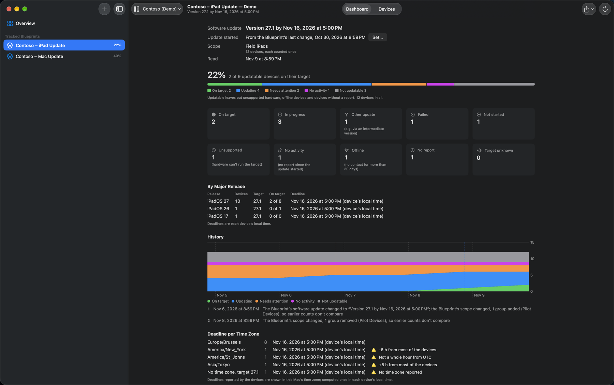

# Software Update Dashboard

A read-only Mac app that shows, for a group of devices, whether they are on the OS version their Blueprint’s software update asks for, and if not, why not.

## Features

- **Tracked Blueprints:** a Blueprint with a software update; its devices are those of the groups it’s scoped to, iPads, iPhones and Macs together, each counted once. Scope changes show in the history. Compare with any group to see which of its devices the Blueprint doesn’t reach.
- **A target per device:** a specific version, the newest release, or the newest minor release of the device’s own major, after the Blueprint’s delay, from Apple’s release data, with its deadline in the device’s local time. A table per platform and major release on the dashboard. An “Update started” date can be set by hand.
- **Nine categories with a diagnosis** for every device: on target, in progress, other update, failed, not started, no activity, offline, no report, and hardware that can’t run the target. The diagnosis says in plain language what stands in the way, such as a passcode, a download problem or a deadline still to come. A device whose target can’t be determined (for example a beta of a newer major) is shown as “Target unknown” with the reason, and isn’t counted.
- **Inspect:** the likely cause for a device, from its inventory, status report and declaration reports.
- **History** of every refresh, per tracked Blueprint.
- **Unsupported hardware** with a replacement list: the model, how many devices, and the last version it can run.
- **Deadlines per time zone:** the deadline is each device’s local time, and unusual time zones are pointed out.
- **Exports:** the device list as CSV, and a summary.
- **Demo Mode:** sample iPads and Macs in the middle of an update, without a Jamf tenant. Blueprint › Demo Situation shows what happens when Apple’s release data can’t be read or the saved list of tracked Blueprints can’t be read.

## Requirements

- macOS 15 or later.
- A Jamf Platform API integration with read permissions only: `blueprints:read`, `devices:read`, `device-groups:read` and `declarations:read`.

## Read only

Software Update Dashboard never changes anything in Jamf. It sends only GET requests (and the sign-in), and asks only for read permissions.

## Network use

- The Jamf Platform API in your region, for the connection in use.
- Apple’s release data: SOFA by Mac Admins Open Source (`sofafeed.macadmins.io`) and Apple’s software lookup service (`gdmf.apple.com`).
- GitHub, to check for updates of the app.

## Where data is stored

- Connections in the app’s settings; client secrets in the Keychain.
- The history of each tracked Blueprint in the app’s container, kept for 180 days. When Apple’s release data can’t be read, a refresh stops and the previous one is kept.
- The activity log (Window › Activity Log) in memory only.

## Building from source

Open `Software Update Dashboard.xcodeproj` in Xcode and run. The app uses [JTKit](https://github.com/JordyThery/JTKit) as a Swift package.

## Credits

Release data from [SOFA](https://sofa.macadmins.io) by Mac Admins Open Source.

## Support

If Software Update Dashboard saves you time, you can [buy me a coffee](https://buymeacoffee.com/jordythery). ☕️

## Disclaimer

This tool is provided as-is, without warranty of any kind. Use it at your own risk. This is a personal project. It is not affiliated with or endorsed by my employer, Jamf or Apple. Issues and pull requests are appreciated. Support is best-effort.

## License

[MIT](LICENSE)
